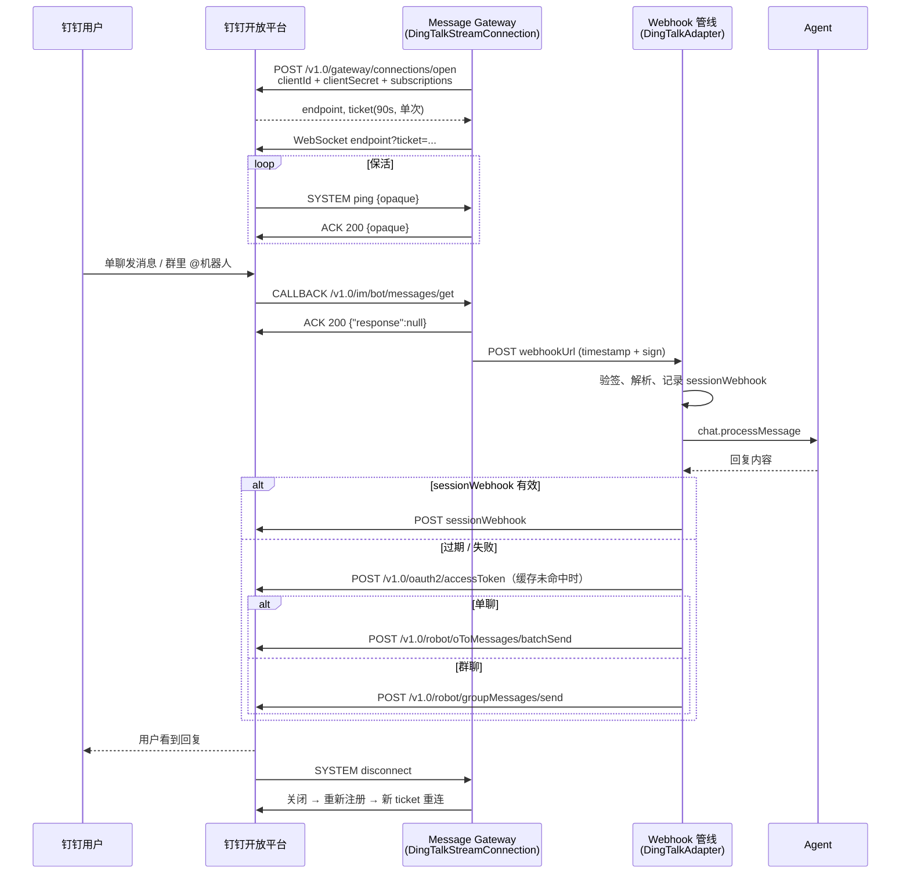

# 钉钉企业内部应用机器人通信协议规范

> 适用对象：实现钉钉机器人消息收发的 SDK、网关和独立 Bot，以及 `packages/chat-adapter-dingtalk`。
>
> 整理依据（核对日期 2026-11-05）：
>
> - 钉钉开放平台文档：[机器人概述](https://open.dingtalk.com/document/orgapp/robot-overview)、[接收消息](https://open.dingtalk.com/document/orgapp/receive-message)、[回复消息](https://open.dingtalk.com/document/orgapp/robot-reply-and-send-messages)、[单聊批量发送](https://open.dingtalk.com/document/orgapp/chatbots-send-one-on-one-chat-messages-in-batches)、[群聊发送](https://open.dingtalk.com/document/orgapp/the-robot-sends-a-group-message)、[消息类型](https://help.dingtalk.io/open/development/robot-message-type)、[获取企业内部应用 accessToken](https://help.dingtalk.io/open/development/obtain-orgapp-token)、[下载机器人接收消息的文件](https://open.dingtalk.com/document/orgapp/download-the-file-content-of-the-robot-receiving-message)。
> - Stream 协议：[Stream 模式介绍](https://open.dingtalk.com/document/resourcedownload/introduction-to-stream-mode)、[developerpedia/stream/protocol.md](https://github.com/open-dingtalk/developerpedia/blob/main/docs/learn/stream/protocol.md)。
> - 官方 SDK 源码：[dingtalk-stream-sdk-nodejs](https://github.com/open-dingtalk/dingtalk-stream-sdk-nodejs)、[dingtalk-stream-sdk-python `chatbot.py`](https://github.com/open-dingtalk/dingtalk-stream-sdk-python/blob/main/dingtalk_stream/chatbot.py)（字段名以 SDK 为准）。
> - 可行性调研：`docs/development/dingtalk-wecom-channel-feasibility.md`（分支 `docs/dingtalk-wecom-feasibility`）。
>
> 标注约定：「工程建议」来自实现经验，不是服务端协议的一部分；「未核实」表示官方文档没写；「未实测」表示还没在真实企业里验证。本文所有内容目前都是「未实测」。

## 1. 概述

钉钉机器人能力挂在「企业内部应用」下：在开发者后台创建应用、开启机器人能力、发布即可使用，**企业内部应用发布无平台审核**。协议特征：

1. **凭证**：应用的 Client ID（原 AppKey）+ Client Secret（原 AppSecret）。OpenAPI 用二者换 `accessToken`（2 小时），请求头 `x-acs-dingtalk-access-token`；Stream 建连直接用 Client ID/Secret。
2. **收消息**：两种模式二选一 ——HTTP 回调（需公网 HTTPS，`timestamp` + `sign` 头签名）或 **Stream 模式**（客户端出站 WebSocket）。群聊只推送 @ 机器人的消息，单聊推送全部消息。
3. **回复**：回调自带临时 `sessionWebhook`（免 token，支持 @）；过期后走 OpenAPI：单聊 `oToMessages/batchSend`，群聊 `groupMessages/send`，二者都需要 `robotCode`。
4. **消息模型**：出站消息用「模板 key + JSON 字符串参数」（`msgKey` + `msgParam`），不支持编辑普通消息；流式输出需要 AI 卡片（本包第一版不做）。

**地址列表**

| 用途                | 地址                                                                                  |
| ------------------- | ------------------------------------------------------------------------------------- |
| OpenAPI 基座        | `https://api.dingtalk.com`                                                            |
| accessToken         | `POST https://api.dingtalk.com/v1.0/oauth2/accessToken`                               |
| Stream 注册         | `POST https://api.dingtalk.com/v1.0/gateway/connections/open`                         |
| Stream WebSocket    | 注册返回的 `endpoint` + `?ticket=...`                                                 |
| 单聊发送            | `POST https://api.dingtalk.com/v1.0/robot/oToMessages/batchSend`                      |
| 群聊发送            | `POST https://api.dingtalk.com/v1.0/robot/groupMessages/send`                         |
| 文件下载码换 URL    | `POST https://api.dingtalk.com/v1.0/robot/messageFiles/download`                      |
| sessionWebhook 回复 | 回调里的 `sessionWebhook`（形如 `https://oapi.dingtalk.com/robot/sendBySession?...`） |

## 2. 方案选择

### 2.1 为什么选 Stream 模式

| 维度             | HTTP 回调                                         | Stream 模式（选用）                                    |
| ---------------- | ------------------------------------------------- | ------------------------------------------------------ |
| 公网入口         | 需要公网 HTTPS 地址，用户要在钉钉后台填我们的 URL | **不需要**公网服务器、IP、域名（官方原文）             |
| 自部署 LobeHub   | 内网部署收不到消息                                | 只要能出站访问 `api.dingtalk.com` 即可                 |
| 用户配置步骤     | 填 URL + 校验签名                                 | 后台选「Stream 模式」即可                              |
| 与现有渠道一致性 | 与 Slack Events / Telegram webhook 一致           | **与飞书长连接、QQ WebSocket、Slack Socket Mode 一致** |
| 官方态度         | 支持                                              | 官方推荐                                               |

结论：钉钉接入走 **Stream 模式**，由 message gateway 维持长连接，把机器人回调转成签名 HTTP POST 投递到 `webhookPath`，复用 `handleWebhook()` 管线 —— 与 `feishu/gateway.ts`、`chat-adapter-qq/src/gateway.ts` 的形态完全一致。`handleWebhook()` 同时兼容 HTTP 回调模式（同一签名算法），自部署用户若坚持用 HTTP 回调也能工作。

### 2.2 自研轻量实现 vs 官方 SDK

**选择：自研轻量实现**（`packages/chat-adapter-dingtalk/src/gateway.ts`，约 330 行，无额外依赖）。理由：

1. **协议很小**：一次 HTTP 注册 + WebSocket + 三类帧（`SYSTEM` / `EVENT` / `CALLBACK`）+ 统一 ACK 格式，自研成本低。
2. **运行时一致**：官方 Node SDK `dingtalk-stream` 依赖 `ws` 与 `axios`；仓库其他 adapter（QQ、飞书 gateway）都使用全局 `fetch` / `WebSocket`，可在 Node 22+ 与 Edge-like 运行时复用，且测试可以直接 stub 全局对象。
3. **生命周期可控**：gateway 需要 `abortSignal`、`durationMs`（由 message gateway 周期性重启）、日志注入、转发签名；官方 SDK 的 `autoReconnect` / `keepAlive` 语义与这些参数需要额外适配。
4. **官方 SDK 仍作为协议参照**：帧结构、`ping` 回显、`disconnect` 处理、重连退避都对齐官方 SDK 行为（见 §4）。

## 3. 认证

### 3.1 获取 accessToken

`POST https://api.dingtalk.com/v1.0/oauth2/accessToken`

```json
{ "appKey": "dingxxxxxxxx", "appSecret": "xxxxxxxx" }
```

响应：

```json
{ "accessToken": "fw8ef8we8f76e6f7s8dxxxx", "expireIn": 7200 }
```

| 字段          | 类型     | 说明                       |
| ------------- | -------- | -------------------------- |
| `accessToken` | `string` | 调用 v1.0 OpenAPI 的凭证。 |
| `expireIn`    | `number` | 有效期，秒，通常 7200。    |

调用方式：请求头 `x-acs-dingtalk-access-token: {accessToken}`。官方提示不要频繁调用 Token 接口，否则可能被限流。

### 3.2 缓存与刷新（实现：`DingTalkApiClient.getAccessToken`）

- **缓存**：按应用缓存在 `DingTalkApiClient` 实例内，过期时间 = `expireIn - 300s`（提前 5 分钟刷新；若 `expireIn` 很短，至少保留一半有效期）。
- **并发去重**：同一时刻多个调用共享一个 in-flight 请求，避免缓存失效瞬间并发打 Token 接口。
- **被动失效**：业务接口返回 `401`，或错误码为 `InvalidAuthentication` / `invalidParameter.token.invalid` / `Forbidden.AccessDenied.AccessTokenInvalid` 时，清空缓存、重新取 token 并**只重试一次**；重试仍失败则抛出 `kind = 'auth'` 错误。
- **凭证错误**：Token 接口返回任意 4xx 统一映射为 `kind = 'auth'`（例如 Client Secret 填错），供上层在渠道配置校验时提示「凭证无效」。
- Stream 注册接口直接使用 Client ID/Secret，不依赖 accessToken。

## 4. Stream 模式

### 4.1 注册连接

`POST https://api.dingtalk.com/v1.0/gateway/connections/open`

```json
{
  "clientId": "dingxxxxxxxx",
  "clientSecret": "xxxxxxxx",
  "subscriptions": [{ "type": "CALLBACK", "topic": "/v1.0/im/bot/messages/get" }],
  "ua": "lobehub-chat-adapter-dingtalk/0.1.0"
}
```

| 字段             | 说明                                                                      |
| ---------------- | ------------------------------------------------------------------------- |
| `subscriptions`  | `type` 为 `EVENT`（`topic: "*"`）或 `CALLBACK`（机器人消息 topic 见上）。 |
| `ua` / `localIp` | 可选，排障用。                                                            |

响应 `{ "endpoint": "wss://...", "ticket": "..." }`。**ticket 90 秒有效且只能建一条连接，不得复用**，所以每次重连都必须重新注册。本实现只订阅机器人消息回调，不订阅事件。

### 4.2 建立 WebSocket

连接 `{endpoint}?ticket={ticket}`（ticket 做 URL 编码）。握手成功（`open`）即视为连接可用：`connect()` 在首次 `open` 时 resolve；注册失败、首次握手前 socket 关闭或报错时 reject（凭证错、应用未开启 Stream 模式等可被上层感知）。

一个应用默认最多 50 条连接，多连接时服务端**随机**选一条推送 —— 多实例部署不需要全局单 owner（与企业微信不同）。

### 4.3 帧结构

服务端推送：

```json
{
  "data": "{\"msgId\":\"...\",\"conversationType\":\"1\",...}",
  "headers": {
    "messageId": "c0a8...",
    "topic": "/v1.0/im/bot/messages/get",
    "contentType": "application/json",
    "time": "1793898634773"
  },
  "specVersion": "1.0",
  "type": "CALLBACK"
}
```

`type` 取值 `SYSTEM` / `EVENT` / `CALLBACK`；`data` 是 **JSON 字符串**。

客户端 ACK：

```json
{
  "code": 200,
  "data": "{\"response\":null}",
  "headers": { "messageId": "c0a8...", "contentType": "application/json" },
  "message": "OK"
}
```

`code`：`200` 成功、`404` 不支持该 topic、`500` 内部错误。

### 4.4 帧处理（实现：`DingTalkStreamConnection.handleFrame`）

| 帧                                                        | 处理                                                                                               |
| --------------------------------------------------------- | -------------------------------------------------------------------------------------------------- |
| `SYSTEM` / `ping`                                         | 原样回显 `data`（含 `opaque`），`code: 200`。                                                      |
| `SYSTEM` / `disconnect`                                   | 服务端约 10 秒后断 TCP；本实现**立即**关闭 socket 并走重连（新 ticket），缩短空窗。无需 ACK。      |
| `SYSTEM` / 其他（`CONNECTED`、`REGISTERED`、`KEEPALIVE`） | 仅记录日志。                                                                                       |
| `CALLBACK` / `/v1.0/im/bot/messages/get`                  | **先 ACK**（`{"response":null}`），再把 `data` 原文签名后 POST 到 `webhookUrl`；转发失败只记日志。 |
| `CALLBACK` / 其他 topic                                   | ACK `404 topic not supported`，不转发。                                                            |
| `EVENT`                                                   | ACK `{"status":"SUCCESS"}`，避免服务端重推（本实现不订阅事件，属兜底）。                           |
| 非 JSON 帧                                                | 丢弃并记录日志。                                                                                   |

机器人消息是 **fire-and-forget**：网络超时不会重推。所以 ACK 不能等 Agent 执行完，必须在收到帧后立即回；Agent 执行在 webhook 管线中异步进行。

### 4.5 转发签名

转发请求使用与 HTTP 回调模式**完全相同**的签名，因此 `handleWebhook()` 用一套校验同时覆盖两种来源，且伪造请求无法冒充钉钉消息：

```
timestamp: <Unix ms>
sign: Base64( HmacSHA256( key = clientSecret, message = timestamp + "\n" + clientSecret ) )
```

`handleWebhook()` 校验：缺失或不匹配返回 `401`；`|now - timestamp| > 1 小时` 视为过期（与钉钉 HTTP 回调规则一致）；比较使用 `timingSafeEqual`。

### 4.6 心跳与存活检测

- **服务端心跳**：服务端定期下发 `ping` 系统帧，客户端回显即可保活（协议原文）。
- **客户端存活检测（工程建议）**：全局 `WebSocket` 无法发送协议层 ping 帧，因此用「空闲看门狗」判断半开连接：任意帧都会刷新 `lastFrameAt`，超过 `idleTimeoutMs`（默认 180 秒，可配置）没有任何帧就主动关闭并重连。检查周期为 `idleTimeoutMs / 4`。
  - 服务端 `ping` 的实际间隔官方未写（未核实）；默认值取得较宽，避免误判抖动。实测后可按真实间隔收紧。
  - 官方 Node SDK 的 `keepAlive` 选项（默认关闭）是每 8 秒发协议层 ping、未收到 pong 即断开，思路相同。

### 4.7 重连

| 触发                                             | 行为                           |
| ------------------------------------------------ | ------------------------------ |
| `disconnect` 系统帧                              | 立即关闭当前 socket → 重连     |
| socket 意外关闭（网络、服务端负载均衡）          | 重连                           |
| 空闲超时                                         | 关闭 → 重连                    |
| 重连时注册接口失败或握手前关闭                   | 继续按退避重试                 |
| `close()`、`abortSignal` 触发、`durationMs` 到期 | 不重连（由调用方决定是否重启） |

- **每次重连都重新调用 `connections/open`**（ticket 单次有效）。
- 退避：`1s × 2^(n-1)`，上限 60 秒，最多 10 次；握手成功后计数清零（与官方 SDK 指数退避一致，上限相同）。
- 首次 `connect()` 失败不会进入重连循环，直接 reject，交给上层把运行状态标为错误。
- 旧 socket 的事件在被替换后一律忽略，避免重复重连。

## 5. 接收消息

### 5.1 回调载荷（`/v1.0/im/bot/messages/get` 的 `data`，或 HTTP 回调 body）

```json
{
  "atUsers": [{ "dingtalkId": "$:LWCP_v1:$bot" }],
  "chatbotCorpId": "dingCorp",
  "chatbotUserId": "$:LWCP_v1:$bot",
  "conversationId": "cidXXXX==",
  "conversationTitle": "研发群",
  "conversationType": "2",
  "createAt": 1793898634773,
  "isAdmin": false,
  "isInAtList": true,
  "msgId": "msgXXXX",
  "msgtype": "text",
  "robotCode": "dingxxxxxxxx",
  "senderCorpId": "dingCorp",
  "senderId": "$:LWCP_v1:$user",
  "senderNick": "张三",
  "senderStaffId": "manager1234",
  "sessionWebhook": "https://oapi.dingtalk.com/robot/sendBySession?session=xxx",
  "sessionWebhookExpiredTime": 1793904034773,
  "text": { "content": " 帮我总结一下" }
}
```

| 字段                        | 说明                                                                                  |
| --------------------------- | ------------------------------------------------------------------------------------- |
| `conversationType`          | `"1"` 单聊，`"2"` 群聊（字符串）。                                                    |
| `conversationId`            | 会话 ID；群聊时即 `openConversationId`，用于 `groupMessages/send`。                   |
| `senderStaffId`             | 发送者在企业内的 userId，**单聊主动发送的收件人**。机器人发布后才有；外部联系人没有。 |
| `senderId`                  | 加密的发送者 ID，始终存在。                                                           |
| `chatbotUserId`             | 机器人自身 ID，用于过滤自己发出的消息。                                               |
| `isInAtList` / `atUsers`    | 是否 @ 了机器人 / 被 @ 的用户（`dingtalkId`、`staffId`）。                            |
| `sessionWebhook`            | 本会话的临时回复地址。                                                                |
| `sessionWebhookExpiredTime` | 过期时间（Unix ms）。有效期文档未写（未核实），官方示例推算约 90 分钟。               |
| `content`                   | 非文本消息的内容（见 §5.3）。                                                         |

### 5.2 单聊 / 群聊 / @ 机器人的识别

| 场景         | 判定                       | thread id                         | `isMention`                |
| ------------ | -------------------------- | --------------------------------- | -------------------------- |
| 单聊         | `conversationType === "1"` | `dingtalk:single:{senderStaffId}` | `isInAtList`（通常 false） |
| 群聊 @机器人 | `conversationType === "2"` | `dingtalk:group:{conversationId}` | **true**                   |

- 群聊**只会推送 @ 机器人的消息**（协议原文），所以群消息一律视为 mention；不需要也无法拿到群内非 @ 消息。
- 单聊 thread 用 `senderStaffId` 编码，因为它正是 `batchSend` 的收件人；外部联系人缺 `senderStaffId` 时回退到 `senderId`（此时只能经 sessionWebhook 回复，见 §6.4）。
- 群聊 `text.content` 中 DingTalk 已去掉 @机器人 本身，但保留前导空白；解析时 `trim`，并把 `U+2005`（钉钉 @ 后的四分之一空格）规范为普通空格。
- `senderId === chatbotUserId` 的消息直接丢弃，防止自激。
- thread id 解析时只按前两个 `:` 切分，其余部分整体作为 id（`senderId` 自带 `:`）。

### 5.3 消息类型映射（入站）

| `msgtype`  | 内容字段                                                           | 映射                                                   |
| ---------- | ------------------------------------------------------------------ | ------------------------------------------------------ |
| `text`     | `text.content`                                                     | `text`                                                 |
| `richText` | `content.richText[]`：`{text}` 或 `{type:'picture', downloadCode}` | 文本片段按顺序拼接为 `text`；每张图片一个 `image` 附件 |
| `picture`  | `content.downloadCode`（兼容 `pictureDownloadCode`）               | `image` 附件，`text` 为空                              |
| `audio`    | `content.downloadCode`、`duration`、`recognition`                  | `text` 取语音识别结果 `recognition`；附 `audio` 附件   |
| `video`    | `content.downloadCode`、`duration`、`videoType`                    | `video` 附件                                           |
| `file`     | `content.downloadCode`、`fileName`                                 | `file` 附件，MIME 按文件名推断                         |
| 其他       | —                                                                  | 有 `text.content` 时按文本处理，否则丢弃               |

- 群里 @ 机器人时收不到 audio、video、file（协议原文），单聊才有。
- 文本为空且没有附件的消息不进入管线。

### 5.4 附件下载

入站附件只有 `downloadCode`，没有 URL：

```
POST /v1.0/robot/messageFiles/download
{ "downloadCode": "...", "robotCode": "dingxxxxxxxx" }
→ { "downloadUrl": "https://..." }   // 临时地址
```

Adapter 生成的 `Attachment`：`fetchData()` 先换 URL 再下载；`fetchMetadata.downloadCode` 保留下载码，消息经队列序列化后可据此重建 fetcher。下载码的有效期文档未写（未核实）。

## 6. 发送消息

### 6.1 出站消息模板（`msgKey` + `msgParam`）

| 用途     | `msgKey`         | `msgParam`                        | sessionWebhook 对应 body                             |
| -------- | ---------------- | --------------------------------- | ---------------------------------------------------- |
| 纯文本   | `sampleText`     | `{"content": "..."}`              | `{"msgtype":"text","text":{"content":"..."}}`        |
| Markdown | `sampleMarkdown` | `{"title": "...", "text": "..."}` | `{"msgtype":"markdown","markdown":{"title","text"}}` |
| 图片     | `sampleImageMsg` | `{"photoURL": "url 或 mediaId"}`  | 以 markdown `` 发送                     |

其他模板（`sampleLink`、`sampleActionCard*`、文件、音视频）本包暂不使用。

**选择规则（`DingTalkFormatConverter.toOutboundMessage`）**：调用方传 `{ markdown }` / `{ ast }`，或文本中出现 markdown 语法（标题、列表、引用、粗体、行内代码、链接）时发 `sampleMarkdown`，否则发 `sampleText`。Markdown 的 `title` 会显示在通知和会话列表里，取首个非空行去掉 markdown 标记，最多 20 字。

**长度**：`groupMessages/send` 的 `msgParam` 上限 15000 字节；正文按 UTF-8 截断到 12000 字节（预留 JSON 转义余量），按字符边界切并追加 `...`。

### 6.2 单聊：`oToMessages/batchSend`

```json
POST /v1.0/robot/oToMessages/batchSend
x-acs-dingtalk-access-token: {accessToken}
{
  "robotCode": "dingxxxxxxxx",
  "userIds": ["manager1234"],
  "msgKey": "sampleMarkdown",
  "msgParam": "{\"title\":\"结论\",\"text\":\"**结论**：可以\"}"
}
→ { "processQueryKey": "...", "invalidStaffIdList": [], "flowControlledStaffIdList": [] }
```

- `userIds` 每次最多 20 个；`msgParam` 是 **JSON 字符串**。
- 该接口对部分失败也返回 200：所有收件人都落在 `invalidStaffIdList`（`kind: 'invalid_request'`）或 `flowControlledStaffIdList`（`kind: 'rate_limit'`）时，本实现抛错。
- 返回的 `processQueryKey` 作为消息 id（可用于查询已读或撤回）。

### 6.3 群聊：`groupMessages/send`

```json
POST /v1.0/robot/groupMessages/send
{
  "robotCode": "dingxxxxxxxx",
  "openConversationId": "cidXXXX==",
  "msgKey": "sampleText",
  "msgParam": "{\"content\":\"done\"}"
}
→ { "processQueryKey": "..." }
```

- 机器人必须已在群内；不支持 @ 人。通过群聊酷应用安装的机器人还需 `coolAppCode`（本包未用）。

### 6.4 sessionWebhook 回复与回退

```json
POST {sessionWebhook}
Content-Type: application/json
{ "msgtype": "text", "text": { "content": "..." }, "at": { "atUserIds": ["manager1234"] } }
→ { "errcode": 0, "errmsg": "ok" }
```

- URL 本身即凭证，不带 accessToken；支持 @（`at.atUserIds`）。第一版回复不主动 @ 发送者，与 OpenAPI 群发行为一致。
- **发送顺序（`DingTalkAdapter.send`）**：
  1. Adapter 在每次收到回调时按 thread 记住最新的 `sessionWebhook` 与过期时间（内存，最多 1000 个 thread，超出淘汰最旧）。
  2. 若存在且距过期超过 30 秒，优先经 sessionWebhook 发送 —— 不占 OpenAPI 调用配额（是否计入官方未写，未核实）、群聊也能工作。
  3. sessionWebhook **缺失、即将过期、HTTP 失败或返回 `errcode != 0`**（会话过期等）时：从缓存删除该地址，回退到 OpenAPI（单聊 `batchSend`，群聊 `groupMessages/send`）。后续同 thread 不再尝试失效的地址。
- sessionWebhook 失败的具体 `errcode` 官方未列（未核实），所以按「任何非 0」判定失效。
- sessionWebhook 发送成功没有消息 id，返回 `session:{timestamp}` 作为占位 id。

### 6.5 编辑、删除、表情、输入中

| 操作     | 处理                                                                        |
| -------- | --------------------------------------------------------------------------- |
| 编辑     | 普通机器人消息不可编辑 → 发送一条新消息（与 QQ 一致）；流式编辑需 AI 卡片。 |
| 删除     | 未实现（撤回接口需要 `processQueryKey`，sessionWebhook 发送拿不到）。       |
| 表情回复 | 机器人无对应接口，空实现。                                                  |
| 输入中   | 无对应接口，空实现。                                                        |
| 历史消息 | 机器人无历史消息接口，`fetchMessages` 返回空。                              |

## 7. 错误映射

v1.0 OpenAPI 错误体：`{ "code": "send.too.fast", "message": "...", "requestid": "..." }`，HTTP 状态多为 400。实现统一抛出 `DingTalkApiError { status, code, kind, requestId }`，`kind` 规则（`classifyDingTalkError`）：

| `kind`            | 判定                                                                                                                                             | 典型 code                                                                          |
| ----------------- | ------------------------------------------------------------------------------------------------------------------------------------------------ | ---------------------------------------------------------------------------------- |
| `auth`            | HTTP 401，或 code ∈ {`InvalidAuthentication`, `invalidParameter.token.invalid`, `Forbidden.AccessDenied.AccessTokenInvalid`}；Token 接口任意 4xx | 凭证错、token 失效                                                                 |
| `rate_limit`      | HTTP 429，或 code 匹配 `throttl` / `too.fast` / `qpslimit` / `too.many`；`batchSend` 全部收件人被流控                                            | `send.too.fast`、`send.byToken.tooFast`、`too.many.people`                         |
| `permission`      | HTTP 403，或 code 以 `Forbidden` 开头，或 ∈ {`send.forbidden`, `bot.forbidden.sendMessage`, `unauthorized`}                                      | 未授权 `qyapi_robot_sendmsg`、IP 白名单、机器人被禁言                              |
| `server`          | HTTP ≥ 500 或 `system.error`                                                                                                                     | `system.error`                                                                     |
| `invalid_request` | 其余 4xx                                                                                                                                         | `invalidParameter.robotCode.*`、`invalid.openConversationId`、`staffId.notExisted` |
| `session_webhook` | sessionWebhook 网络失败、非 2xx 或 `errcode != 0`                                                                                                | —（触发 §6.4 回退，不向上抛）                                                      |

Adapter 层：`rate_limit` 转成 chat SDK 的 `RateLimitError`（`cause` 保留原错误），其余原样抛出。

**月度推送配额**：免费标准版组织的 Webhook + Stream 推送合计 5000 次 / 月，超出后机器人只收到错误码 20001、内容为空（见可行性调研）。该载荷的具体形态未核实；当前实现会因缺少有效内容而丢弃，识别并在渠道状态里提示留给平台接入任务。

## 8. 完整消息流程



## 9. 附录：与其他平台对比

| 维度     | 飞书 / Lark                | QQ 开放平台                        | 钉钉                                                |
| -------- | -------------------------- | ---------------------------------- | --------------------------------------------------- |
| 收消息   | 长连接（SDK）或 HTTP 回调  | WebSocket 或 HTTP 回调             | **Stream（WebSocket）** 或 HTTP 回调                |
| 建连     | SDK 内部完成               | `GET /gateway` → Identify/Resume   | `connections/open` → 一次性 ticket，无 session 恢复 |
| 心跳     | SDK 内部                   | 客户端按 `heartbeat_interval` 发送 | 服务端发 `ping`，客户端回显                         |
| ACK      | SDK 内部                   | HTTP 回调需回 op 12                | 每个 CALLBACK 帧都要回 ACK 帧                       |
| 群聊触发 | @ 或群内全部（取决于权限） | 仅 @                               | 仅 @                                                |
| 回复     | message API（可编辑）      | 被动回复需 `msg_id`                | `sessionWebhook`（临时）或 OpenAPI 主动发送         |
| 编辑消息 | 支持                       | 不支持                             | 普通消息不支持（AI 卡片可流式更新）                 |
| 认证     | app_id + app_secret        | appId + clientSecret               | Client ID + Client Secret（2h accessToken）         |

## 10. 实现与验证记录

### 10.1 代码位置

`packages/chat-adapter-dingtalk/src/`：

| 文件                  | 职责                                                                                                                           |
| --------------------- | ------------------------------------------------------------------------------------------------------------------------------ |
| `types.ts`            | 回调载荷、Stream 帧、OpenAPI 请求 / 响应类型与常量                                                                             |
| `api.ts`              | `DingTalkApiClient`：token 缓存 / 刷新、Stream 注册、单聊 / 群聊 /sessionWebhook 发送、文件下载；`DingTalkApiError` 与错误分类 |
| `crypto.ts`           | 回调签名与校验（HTTP 回调模式 + gateway 转发共用）                                                                             |
| `gateway.ts`          | `DingTalkStreamConnection`：注册、握手、ping/ACK、转发、看门狗、重连                                                           |
| `format-converter.ts` | mdast ⇄ markdown、出站模板选择、markdown 标题生成                                                                              |
| `adapter.ts`          | `DingTalkAdapter`（chat SDK `Adapter`）：验签、解析、thread 编码、发送与回退                                                   |

### 10.2 单元测试

`bunx vitest run`（包目录）覆盖：gateway 握手 /ping 回显 / CALLBACK ACK 与签名转发 / 404 topic /disconnect 重连 / 退避与计数重置 / 空闲看门狗 /abort/durationMs；入站单聊、群聊 @、外部联系人、richText、picture、audio、video、file、空消息、自身消息、验签失败与过期；出站 sessionWebhook 优先、单聊 batchSend、群聊 groupMessages、sessionWebhook 失效回退、过期跳过、限流映射、token 过期刷新重试、错误分类表、UTF-8 截断。

### 10.3 未实测清单

| #   | 项                                                                            |
| --- | ----------------------------------------------------------------------------- |
| D1  | 真实企业中 Stream 单聊、群聊 @ 收发                                           |
| D2  | `sessionWebhook` 实际有效期与失效时的 `errcode`                               |
| D3  | 服务端 `ping` 的实际间隔（决定 `idleTimeoutMs` 能否收紧）                     |
| D4  | 群聊 `text.content` 是否总是去掉 @机器人（含多人 @ 场景）                     |
| D5  | 20001 配额耗尽载荷形态                                                        |
| D6  | 入站图片下载码有效期、下载后 MIME（当前图片 / 音视频不预设 MIME，由下游嗅探） |
