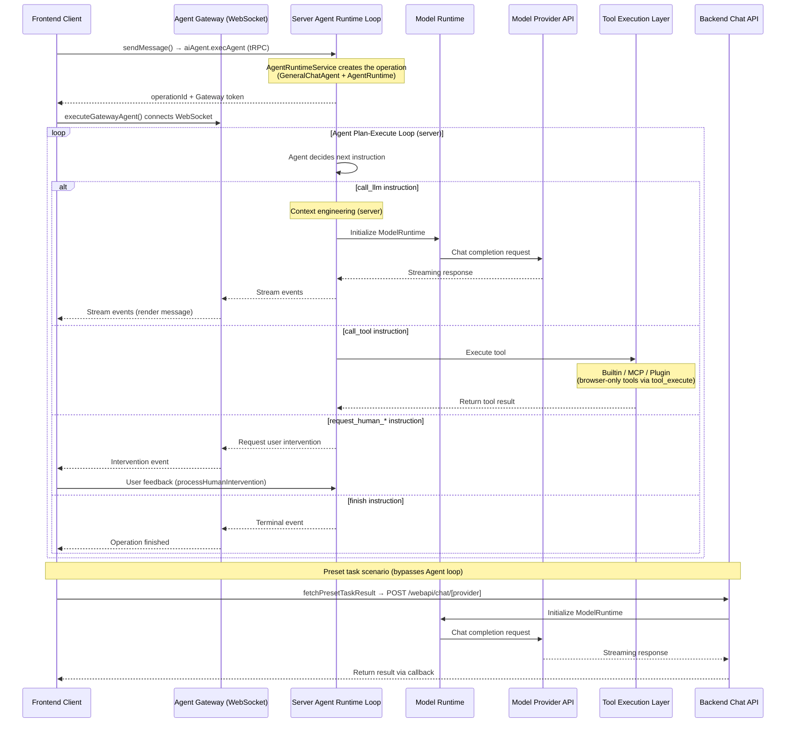

# Chat API Internals and Client-Server Interaction

This page is for developers changing or debugging LobeHub source code. It explains internal chat flows, event sequences, and core components.

<Callout type="warning">
  This is not a public REST API or SDK integration guide. `/webapi/chat/[provider]`, internal tRPC
  routes, store actions, and ChatService are application implementation details, not a stable
  external integration contract. Do not infer public authentication, request formats, or
  compatibility guarantees from the sequence diagram below.
</Callout>

For CLI, public API, or TypeScript SDK integration, start with [Choose a Development Path](/docs/development/start#choose-a-development-path). The snippets below explain internal control flow; they are not standalone client examples. Compare them with the source for your version.

## Scope

The diagram below follows an Agent run. The Agent loop always runs on the server and streams to the browser over the Agent Gateway WebSocket; see [Server-Side Execution and the Agent Gateway](#server-side-execution-and-the-agent-gateway). Different transports and execution scenarios do not necessarily follow an identical path.

Here, a "preset task" is an internal helper that calls a model directly. It is not a user-created Task or Scheduled automation. For user-facing work records, see [Task](/docs/usage/getting-started/task).

## Interaction Sequence Diagram



## Main Process Steps

### 1. Client Initiates Request

After the user sends a message, `sendMessage()`
(`src/store/chat/slices/agentRun/actions/entries/conversationLifecycle.ts`)
creates the user message and assistant message placeholder,
then calls `executeGatewayAgent()`
(`src/store/chat/slices/agentRun/actions/transports/gateway/gateway.ts`).
It starts the run on the server through the `aiAgent.execAgent` tRPC route
(`apps/server/src/routers/lambda/aiAgent.ts`) and subscribes to the
operation's events over the Agent Gateway WebSocket.

If the deployment has no Agent Gateway configured, the send fails with
"This deployment has no Agent Gateway configured…". There is no browser-side
fallback.

### 2. Agent Runtime Drives the Loop

The Agent chat flow is driven by the `AgentRuntime.step()` loop on the server. Preset tasks described below call the model directly and bypass this loop.

**Initialization**
(`AgentRuntimeService.createOperation()` in
`apps/server/src/services/agentRuntime/AgentRuntimeService/executeStep/index.ts`):

1. Resolve agent config (model, provider, plugin list, etc.)
2. Create the tool registry (`apps/server/src/modules/Mecha/AgentToolsEngine/`)
3. Create `GeneralChatAgent` (the "brain" that decides
   what to do next) and `AgentRuntime` (the "engine"
   that executes instructions)
4. Bind the shared package executors to server transports via `createRuntimeExecutors()`
   (`apps/server/src/modules/AgentRuntime/RuntimeExecutors.ts`)

**Execution Loop** (`AgentRuntimeService.executeStep()`):

```ts
while (state.status !== 'done' && state.status !== 'error') {
  result = await runtime.step(state, nextContext);
  // GeneralChatAgent decides: call_llm → call_tool → call_llm → finish
}
```

At each step, `GeneralChatAgent` returns an
`AgentInstruction` based on current state,
and `AgentRuntime` executes it via the corresponding
executor:

- `call_llm`: Call the LLM (see steps 3-5 below)
- `call_tool`: Execute tool calls (see step 6 below)
- `finish`: End the loop
- `compress_context`: Context compression
- `request_human_approve` / `request_human_prompt` /
  `request_human_select`: Request user intervention

### 3. Server Prepares the LLM Request

When the Agent issues a `call_llm` instruction,
the server-side executor prepares the request:

- Modules under `apps/server/src/modules/Mecha/` perform
  context engineering, including agent config resolution,
  model parameter resolution, MCP context injection, etc.
- `initModelRuntimeFromDB` (`apps/server/src/modules/ModelRuntime/index.ts`)
  reads the user's provider config from the database
  and initializes ModelRuntime

### 4. Providers Only the User's Device Can Reach

A provider only the user's device can reach (Ollama, LM Studio,
or a provider with "client fetch" enabled) is still called by the server
loop, but that single LLM call is relayed to the browser tab that started
the run:

- The server sends an `llm_execute` event over the Agent Gateway
  (`apps/server/src/modules/AgentRuntime/llmRelay/`)
- The browser executes the call and streams the result back
  (`src/services/llmRelay/`)
- The loop itself, tool calls, and persistence stay on the server

### 5. Model Call and Response Processing

- `ModelRuntime`
  (`packages/model-runtime/src/core/ModelRuntime.ts`)
  calls the respective model provider's API
  and returns a streaming response
- The server loop handles different types of events
  (text, tool calls, reasoning, etc.), persists the message,
  and publishes stream events to the Agent Gateway
- The browser receives them over the WebSocket and updates the message
  (`src/store/chat/slices/agentRun/actions/transports/gateway/gatewayEventHandler.ts`)

### 6. Tool Calling Scenario

When the AI model returns a `tool_calls` field in its
response, the Agent issues a `call_tool` instruction.
LobeHub supports three types of tools:

The server dispatches tool calls through `ToolExecutionService`
(`apps/server/src/services/toolExecution/index.ts`).

**Builtin Tools**: Tools built into the application,
executed by server-side executors.

- Server runtimes live in
  `apps/server/src/services/toolExecution/serverRuntimes/`
- Includes built-in features like search,
  image generation, etc.

**MCP Tools**: External tools connected via
[Model Context Protocol](https://modelcontextprotocol.io/).

- The server calls the MCP server through `MCPService`
- Supports three connection modes:
  stdio, HTTP (streamable-http/SSE), and cloud (Composio)
- MCP tool registration and discovery is managed
  through MCP server configuration

**Plugin Tools**: Legacy plugin system,
invoked via API gateway.
This system is expected to be gradually deprecated
in favor of the MCP tool system.

**Browser-only tools**: A tool that can only run on the user's
device (for example a local-system tool or a device-only MCP server)
is sent to the browser as a `tool_execute` event over the Agent Gateway
(`apps/server/src/modules/AgentRuntime/dispatchClientTool.ts`).
The browser runs it
(`src/store/chat/slices/agentRun/actions/transports/client/clientToolExecution.ts`)
and sends the result back; the server waits for it and continues the loop.

After tool execution completes, results are written to
the message and returned to the Agent loop.
The Agent then calls the LLM again to generate
the final response based on tool results.

### 7. Preset Task Processing

Preset tasks are predefined functions typically triggered
when users perform specific actions
(bypassing the Agent Runtime loop, calling LLM directly).
These tasks use the `fetchPresetTaskResult` method
(`src/services/chat/index.ts`), which POSTs to
`/webapi/chat/[provider]`
(`src/app/(backend)/webapi/chat/[provider]/route.ts`)
with specially designed prompt chains. The server makes the model call,
or relays it to the browser for a provider only the user's device can reach.

**Execution Timing**:

1. **Agent Information Auto-generation**: Triggered when
   users create or edit an agent
   - Agent avatar generation (via `autoPickEmoji` method)
   - Agent description generation
     (via `autocompleteAgentDescription` method)
   - Agent tag generation
     (via `autocompleteAgentTags` method)
   - Agent title generation
     (via `autocompleteAgentTitle` method)
2. **Message Translation**: Triggered when users manually
   click the translate button
   (via `translateMessage` method)
3. **Web Search**: When search is enabled but the model
   doesn't support tool calling, search functionality
   is implemented via `fetchPresetTaskResult`

**Code Examples**:

Agent avatar auto-generation implementation:

```ts
// src/features/AgentSetting/store/action.ts
autoPickEmoji: async () => {
  const { config, meta, dispatchMeta } = get();
  const systemRole = config.systemRole;

  chatService.fetchPresetTaskResult({
    onFinish: async (emoji) => {
      dispatchMeta({ type: 'update', value: { avatar: emoji } });
    },
    onLoadingChange: (loading) => {
      get().updateLoadingState('avatar', loading);
    },
    params: merge(
      get().internal_getSystemAgentForMeta(),
      chainPickEmoji(
        [meta.title, meta.description, systemRole]
          .filter(Boolean)
          .join(','),
      ),
    ),
    trace: get().getCurrentTracePayload({
      traceName: TraceNameMap.EmojiPicker,
    }),
  });
};
```

Translation feature implementation:

```ts
// src/store/chat/slices/translate/action.ts
translateMessage: async (id, targetLang) => {
  // ...omitted code...

  // Detect language
  chatService.fetchPresetTaskResult({
    onFinish: async (data) => {
      if (data && supportLocales.includes(data)) from = data;
      await updateMessageTranslate(id, {
        content,
        from,
        to: targetLang,
      });
    },
    params: merge(
      translationSetting,
      chainLangDetect(message.content),
    ),
    trace: get().getCurrentTracePayload({
      traceName: TraceNameMap.LanguageDetect,
    }),
  });

  // Perform translation
  chatService.fetchPresetTaskResult({
    onMessageHandle: (chunk) => {
      if (chunk.type === 'text') {
        content = chunk.text;
        internal_dispatchMessage({
          id,
          type: 'updateMessageTranslate',
          value: { content, from, to: targetLang },
        });
      }
    },
    onFinish: async () => {
      await updateMessageTranslate(id, {
        content,
        from,
        to: targetLang,
      });
      internal_toggleChatLoading(
        false,
        id,
        n('translateMessage(end)', { id }) as string,
      );
    },
    params: merge(
      translationSetting,
      chainTranslate(message.content, targetLang),
    ),
    trace: get().getCurrentTracePayload({
      traceName: TraceNameMap.Translation,
    }),
  });
};
```

### 8. Completion

When the Agent issues a `finish` instruction,
the loop ends on the server, and the Agent Gateway delivers the
terminal event to the browser, which finalizes the message.

## Server-Side Execution and the Agent Gateway

Every Agent run executes on the server; the browser never runs
the Agent Runtime loop:

- **Entry point**: the `aiAgent.execAgent` tRPC route
  (`apps/server/src/routers/lambda/aiAgent.ts`) starts the operation,
  and `AgentRuntimeService.executeStep()`
  (`apps/server/src/services/agentRuntime/AgentRuntimeService/executeStep/index.ts`)
  runs each step. Regular 1:1 chat, continue generation, group chat,
  sub-agent tasks, and API/Cron triggers all use this loop.
- **Streaming**: the server publishes step events to the Agent Gateway,
  and the browser subscribes over WebSocket through `executeGatewayAgent()`
  (`src/store/chat/slices/agentRun/actions/transports/gateway/gateway.ts`).
- **Device-only work**: browser-only tools (`tool_execute`) and LLM calls to
  providers only the user's device can reach (`llm_execute`) are relayed to
  the browser tab one call at a time; the loop stays on the server.
- **Gateway required**: without an Agent Gateway configured, Agents cannot
  run at all. Preset tasks call `/webapi/chat/[provider]` directly, so they
  still work for providers the server can reach; relaying a device-only
  provider also goes through the Agent Gateway.

## Model Runtime

Model Runtime (`packages/model-runtime/`) is the core
abstraction layer in LobeHub for interacting with
LLM model providers, adapting different provider APIs
into a unified interface.

**Core Responsibilities**:

- **Unified Abstraction Layer**: Hides differences
  between AI provider APIs through the `LobeRuntimeAI`
  interface
  (`packages/model-runtime/src/core/BaseAI.ts`)
- **Model Initialization**: Initializes the corresponding
  runtime instance through the provider mapping table
  (`packages/model-runtime/src/runtimeMap.ts`)
- **Capability Encapsulation**: `chat` (streaming chat),
  `models` (model listing), `embeddings` (text embeddings),
  `createImage` (image generation),
  `textToSpeech` (speech synthesis),
  `generateObject` (structured output)

**Core Interface**:

```ts
// packages/model-runtime/src/core/BaseAI.ts
export interface LobeRuntimeAI {
  baseURL?: string;
  chat?(
    payload: ChatStreamPayload,
    options?: ChatMethodOptions,
  ): Promise<Response>;
  generateObject?(
    payload: GenerateObjectPayload,
    options?: GenerateObjectOptions,
  ): Promise<any>;
  embeddings?(
    payload: EmbeddingsPayload,
    options?: EmbeddingsOptions,
  ): Promise<Embeddings[]>;
  models?(): Promise<any>;
  createImage?: (
    payload: CreateImagePayload,
  ) => Promise<CreateImageResponse>;
  textToSpeech?: (
    payload: TextToSpeechPayload,
    options?: TextToSpeechOptions,
  ) => Promise<ArrayBuffer>;
}
```

**Adapter Architecture**: Through two factory functions —
`openaiCompatibleFactory` and
`anthropicCompatibleFactory` — most providers can be
integrated with minimal configuration. Currently supports
over 40 model providers (OpenAI, Anthropic, Google,
Azure, Bedrock, Ollama, etc.), with implementations
in `packages/model-runtime/src/providers/`.

## Agent Runtime

Agent Runtime (`packages/agent-runtime/`) is LobeHub's
agent orchestration engine. As described above, it is the
core execution engine that drives the entire chat flow.

**Core Components**:

- **`AgentRuntime`**
  (`packages/agent-runtime/src/core/runtime.ts`):
  The "engine" that executes the Agent instruction loop,
  supporting `call_llm`, `call_tool`, `finish`,
  `compress_context`, `request_human_*`, etc.
- **`GeneralChatAgent`**
  (`packages/agent-runtime/src/agents/GeneralChatAgent.ts`):
  The "brain" that decides which instruction to execute
  next based on current state
- **`GroupOrchestrationRuntime`**
  (`packages/agent-runtime/src/groupOrchestration/`):
  Multi-agent orchestration supporting speak / broadcast /
  delegate / executeTask collaboration modes
- **`UsageCounter`**: Token usage and cost tracking
- **`InterventionChecker`**:
  Security blacklist for managing agent behavior boundaries
