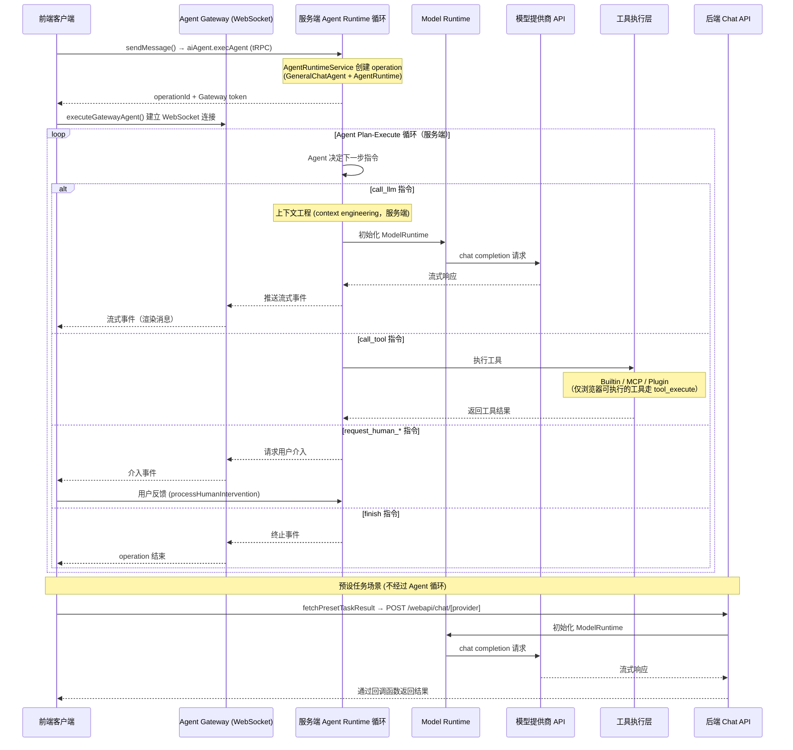

# Chat API 内部实现与前后端交互

本文面向修改或调试 LobeHub 源码的开发者，说明应用内部聊天链路、事件序列及核心组件。

<Callout type="warning">
  本文不是公开 REST API 或 SDK 接入指南。`/webapi/chat/[provider]`、内部 tRPC 路由、
  Store actions 和 ChatService 是应用实现细节，不构成外部集成的稳定契约。
  不要从以下时序图推断公开接口的认证、请求格式或兼容性保证。
</Callout>

需要 CLI、公开 API 或 TypeScript SDK 时，先阅读[开发路径选择](/zh/docs/development/start#选择开发路径)。以下代码片段用于解释内部控制流，不是可独立运行的客户端示例；阅读时应对照所用版本的源码。

## 本页范围

下方时序图展开一次 Agent 运行。Agent 循环始终在服务端运行，并通过 Agent Gateway WebSocket 流式推送到浏览器，详见[服务端执行与 Agent Gateway](#服务端执行与-agent-gateway)。不同 transport 和执行场景不应被当作完全相同的链路。

本文中的「预设任务」指应用内部直接调用模型的辅助功能，不是用户在任务面板创建的 Task 或 Scheduled 自动化任务。用户任务说明见[任务](/zh/docs/usage/getting-started/task)。

## 交互时序图



## 主要步骤说明

### 1. 客户端发起请求

用户发送消息后，`sendMessage()`
（`src/store/chat/slices/agentRun/actions/entries/conversationLifecycle.ts`）
创建用户消息和助手消息占位，然后调用 `executeGatewayAgent()`
（`src/store/chat/slices/agentRun/actions/transports/gateway/gateway.ts`）。
它通过 `aiAgent.execAgent` tRPC 路由
（`apps/server/src/routers/lambda/aiAgent.ts`）在服务端启动运行，
并通过 Agent Gateway WebSocket 订阅该 operation 的事件。

如果部署没有配置 Agent Gateway，发送会失败并提示
"This deployment has no Agent Gateway configured…"，不存在浏览器端回退。

### 2. Agent Runtime 驱动循环

Agent 聊天链路由服务端的 `AgentRuntime.step()` 循环驱动。下文的预设任务直接调用模型，不经过该循环。

**初始化**
（`apps/server/src/services/agentRuntime/AgentRuntimeService.ts` 中的
`AgentRuntimeService.createOperation()`）：

1. 解析 agent 配置（模型、provider、插件列表等）
2. 创建工具注册表（`apps/server/src/modules/Mecha/AgentToolsEngine/`）
3. 创建 `GeneralChatAgent`（"大脑"，决定下一步做什么）
   和 `AgentRuntime`（"引擎"，执行指令）
4. 通过 `createRuntimeExecutors()`
   （`apps/server/src/modules/AgentRuntime/RuntimeExecutors.ts`）
   将 package 共享执行器绑定到服务端 transport

**执行循环**（`AgentRuntimeService.executeStep()`）：

```ts
while (state.status !== 'done' && state.status !== 'error') {
  result = await runtime.step(state, nextContext);
  // GeneralChatAgent 决定: call_llm → call_tool → call_llm → finish
}
```

每一步中，`GeneralChatAgent` 根据当前状态返回一条
`AgentInstruction`，`AgentRuntime` 通过对应的 executor 执行：

- `call_llm`：调用 LLM（见下方步骤 3-5）
- `call_tool`：执行工具调用（见下方步骤 6）
- `finish`：结束循环
- `compress_context`：上下文压缩
- `request_human_approve` / `request_human_prompt` /
  `request_human_select`：请求用户介入

### 3. 服务端准备 LLM 请求

当 Agent 发出 `call_llm` 指令时，服务端 executor 准备请求：

- `apps/server/src/modules/Mecha/` 下的模块完成上下文工程
  （context engineering），包括 agent 配置解析、
  模型参数解析、MCP 上下文注入等
- `initModelRuntimeFromDB`（`apps/server/src/modules/ModelRuntime/index.ts`）
  从数据库读取用户的 provider 配置，初始化 ModelRuntime

### 4. 只有用户设备能访问的 Provider

只有用户设备能访问的 provider（Ollama、LM Studio，或开启了「客户端请求模式」的
provider）仍由服务端循环调用，但这一次 LLM 调用会转交给发起运行的浏览器标签页执行：

- 服务端通过 Agent Gateway 发送 `llm_execute` 事件
  （`apps/server/src/modules/AgentRuntime/llmRelay/`）
- 浏览器执行该调用并将结果流式回传（`src/services/llmRelay/`）
- 循环本身、工具调用和持久化仍在服务端

### 5. 模型调用与响应处理

- `ModelRuntime`
  （`packages/model-runtime/src/core/ModelRuntime.ts`）
  调用相应模型提供商的 API，返回流式响应
- 服务端循环处理不同类型的事件（文本、工具调用、推理等），
  持久化消息，并向 Agent Gateway 发布流式事件
- 浏览器通过 WebSocket 接收事件并更新消息
  （`src/store/chat/slices/agentRun/actions/transports/gateway/gatewayEventHandler.ts`）

### 6. 工具调用场景

当 AI 模型在响应中返回 `tool_calls` 字段时，Agent 会发出
`call_tool` 指令。LobeHub 支持三种工具类型：

服务端通过 `ToolExecutionService`
（`apps/server/src/services/toolExecution/index.ts`）分发工具调用。

**Builtin 工具**：内置在应用中的工具，由服务端执行器运行。

- 服务端运行时位于
  `apps/server/src/services/toolExecution/serverRuntimes/`
- 包括搜索、图像生成等内置功能

**MCP 工具**：通过
[Model Context Protocol](https://modelcontextprotocol.io/)
连接的外部工具。

- 服务端通过 `MCPService` 调用 MCP 服务器
- 支持 stdio、HTTP（streamable-http/SSE）
  和云端（Composio）三种连接方式
- MCP 工具的注册和发现通过 MCP 服务器配置管理

**Plugin 工具**：传统插件体系，通过 API 网关调用。
该体系预期将逐步废弃，由 MCP 工具体系替代。

**仅浏览器可执行的工具**：只能在用户设备上运行的工具
（例如本地系统工具或仅设备可达的 MCP 服务器）会以 `tool_execute` 事件
通过 Agent Gateway 发送给浏览器
（`apps/server/src/modules/AgentRuntime/dispatchClientTool.ts`）。
浏览器执行该工具
（`src/store/chat/slices/agentRun/actions/transports/client/clientToolExecution.ts`）
并回传结果，服务端等待结果后继续循环。

工具执行完成后，结果写入消息并返回给 Agent 循环，
Agent 会再次调用 LLM 基于工具结果生成最终响应。

### 7. 预设任务处理

预设任务是系统预定义的特定功能任务，
通常在用户执行特定操作时触发
（不经过 Agent Runtime 循环，直接调用 LLM）。
这些任务使用 `fetchPresetTaskResult` 方法
（`src/services/chat/index.ts`）执行，
该方法携带专门设计的提示词（prompt chain）POST 到 `/webapi/chat/[provider]`
（`src/app/(backend)/webapi/chat/[provider]/route.ts`）。
由服务端调用模型；对于只有用户设备能访问的 provider，则转交给浏览器执行。

**执行时机**：

1. **角色信息自动生成**：当用户创建或编辑角色时触发
   - 角色头像生成（通过 `autoPickEmoji` 方法）
   - 角色描述生成（通过 `autocompleteAgentDescription` 方法）
   - 角色标签生成（通过 `autocompleteAgentTags` 方法）
   - 角色标题生成（通过 `autocompleteAgentTitle` 方法）
2. **消息翻译**：用户手动点击翻译按钮时触发
   （通过 `translateMessage` 方法）
3. **网页搜索**：当启用搜索但模型不支持工具调用时，
   通过 `fetchPresetTaskResult` 实现搜索功能

**实际代码示例**：

角色头像自动生成实现：

```ts
// src/features/AgentSetting/store/action.ts
autoPickEmoji: async () => {
  const { config, meta, dispatchMeta } = get();
  const systemRole = config.systemRole;

  chatService.fetchPresetTaskResult({
    onFinish: async (emoji) => {
      dispatchMeta({ type: 'update', value: { avatar: emoji } });
    },
    onLoadingChange: (loading) => {
      get().updateLoadingState('avatar', loading);
    },
    params: merge(
      get().internal_getSystemAgentForMeta(),
      chainPickEmoji(
        [meta.title, meta.description, systemRole]
          .filter(Boolean)
          .join(','),
      ),
    ),
    trace: get().getCurrentTracePayload({
      traceName: TraceNameMap.EmojiPicker,
    }),
  });
};
```

翻译功能实现：

```ts
// src/store/chat/slices/translate/action.ts
translateMessage: async (id, targetLang) => {
  // ...省略部分代码...

  // 检测语言
  chatService.fetchPresetTaskResult({
    onFinish: async (data) => {
      if (data && supportLocales.includes(data)) from = data;
      await updateMessageTranslate(id, {
        content,
        from,
        to: targetLang,
      });
    },
    params: merge(
      translationSetting,
      chainLangDetect(message.content),
    ),
    trace: get().getCurrentTracePayload({
      traceName: TraceNameMap.LanguageDetect,
    }),
  });

  // 执行翻译
  chatService.fetchPresetTaskResult({
    onMessageHandle: (chunk) => {
      if (chunk.type === 'text') {
        content = chunk.text;
        internal_dispatchMessage({
          id,
          type: 'updateMessageTranslate',
          value: { content, from, to: targetLang },
        });
      }
    },
    onFinish: async () => {
      await updateMessageTranslate(id, {
        content,
        from,
        to: targetLang,
      });
      internal_toggleChatLoading(
        false,
        id,
        n('translateMessage(end)', { id }) as string,
      );
    },
    params: merge(
      translationSetting,
      chainTranslate(message.content, targetLang),
    ),
    trace: get().getCurrentTracePayload({
      traceName: TraceNameMap.Translation,
    }),
  });
};
```

### 8. 完成

当 Agent 发出 `finish` 指令时，服务端循环结束，
Agent Gateway 将终止事件推送到浏览器，浏览器完成消息的最终更新。

## 服务端执行与 Agent Gateway

所有 Agent 运行都在服务端执行，浏览器不再运行 Agent Runtime 循环：

- **入口**：`aiAgent.execAgent` tRPC 路由
  （`apps/server/src/routers/lambda/aiAgent.ts`）启动 operation，
  `AgentRuntimeService.executeStep()`
  （`apps/server/src/services/agentRuntime/AgentRuntimeService.ts`）
  执行每一步。常规 1:1 对话、继续生成、群聊、子 agent 任务、
  API/Cron 触发都使用这一循环。
- **流式推送**：服务端将步骤事件发布到 Agent Gateway，
  浏览器通过 `executeGatewayAgent()`
  （`src/store/chat/slices/agentRun/actions/transports/gateway/gateway.ts`）
  以 WebSocket 订阅。
- **仅设备可执行的工作**：仅浏览器可执行的工具（`tool_execute`）和
  只有用户设备能访问的 provider 的 LLM 调用（`llm_execute`）
  会逐次转交给浏览器标签页执行，循环仍在服务端。
- **必须配置 Gateway**：未配置 Agent Gateway 时 Agent 完全无法运行。
  预设任务直接调用 `/webapi/chat/[provider]`，因此对服务端可访问的
  provider 仍可使用；转交只有设备能访问的 provider 同样需要经过 Agent Gateway。

## Model Runtime

Model Runtime（`packages/model-runtime/`）是 LobeHub 中
与 LLM 模型提供商交互的核心抽象层，
负责将不同提供商的 API 适配为统一接口。

**核心职责**：

- **统一抽象层**：通过 `LobeRuntimeAI` 接口
  （`packages/model-runtime/src/core/BaseAI.ts`）
  隐藏不同 AI 提供商 API 的差异
- **模型初始化**：通过 provider 映射表
  （`packages/model-runtime/src/runtimeMap.ts`）
  初始化对应的运行时实例
- **能力封装**：`chat`（聊天流式请求）、
  `models`（模型列表）、`embeddings`（文本嵌入）、
  `createImage`（图像生成）、`textToSpeech`（语音合成）、
  `generateObject`（结构化输出）

**核心接口**：

```ts
// packages/model-runtime/src/core/BaseAI.ts
export interface LobeRuntimeAI {
  baseURL?: string;
  chat?(
    payload: ChatStreamPayload,
    options?: ChatMethodOptions,
  ): Promise<Response>;
  generateObject?(
    payload: GenerateObjectPayload,
    options?: GenerateObjectOptions,
  ): Promise<any>;
  embeddings?(
    payload: EmbeddingsPayload,
    options?: EmbeddingsOptions,
  ): Promise<Embeddings[]>;
  models?(): Promise<any>;
  createImage?: (
    payload: CreateImagePayload,
  ) => Promise<CreateImageResponse>;
  textToSpeech?: (
    payload: TextToSpeechPayload,
    options?: TextToSpeechOptions,
  ) => Promise<ArrayBuffer>;
}
```

**适配器架构**：通过 `openaiCompatibleFactory` 和
`anthropicCompatibleFactory` 两种工厂函数，
大多数提供商只需少量配置即可接入。
目前支持超过 40 个模型提供商
（OpenAI、Anthropic、Google、Azure、Bedrock、Ollama 等），
各实现位于 `packages/model-runtime/src/providers/`。

## Agent Runtime

Agent Runtime（`packages/agent-runtime/`）是
LobeHub 的 Agent 编排引擎。
如上文所述，它是驱动整个 chat 流程的核心执行引擎。

**核心组件**：

- **`AgentRuntime`**
  （`packages/agent-runtime/src/core/runtime.ts`）：
  "引擎"，执行 Agent 指令循环，
  支持 `call_llm`、`call_tool`、`finish`、
  `compress_context`、`request_human_*` 等指令类型
- **`GeneralChatAgent`**
  （`packages/agent-runtime/src/agents/GeneralChatAgent.ts`）：
  "大脑"，根据当前状态决定下一步执行什么指令
- **`GroupOrchestrationRuntime`**
  （`packages/agent-runtime/src/groupOrchestration/`）：
  多 Agent 编排，支持 speak /broadcast/
  delegate /executeTask 等协作模式
- **`UsageCounter`**：token 使用和费用追踪
- **`InterventionChecker`**：
  安全黑名单管理 Agent 行为边界
